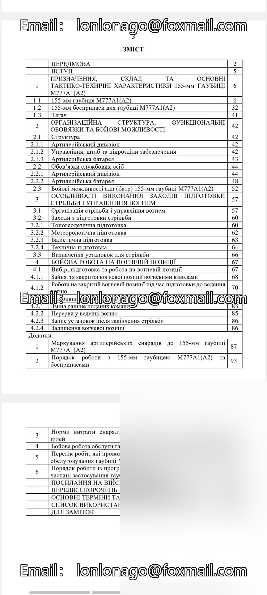
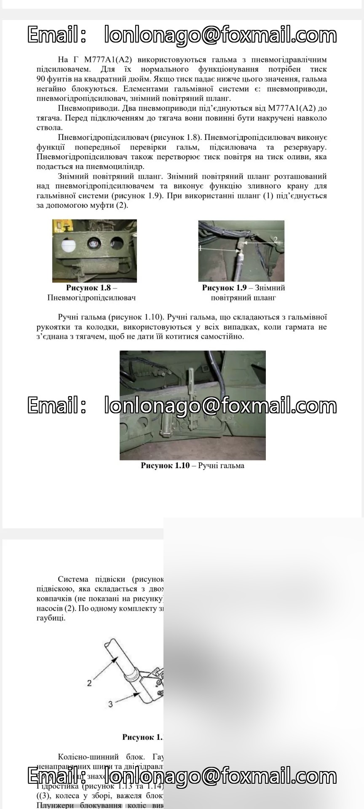
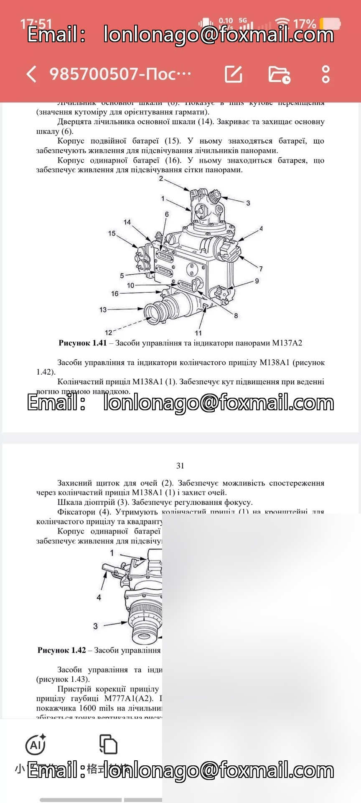
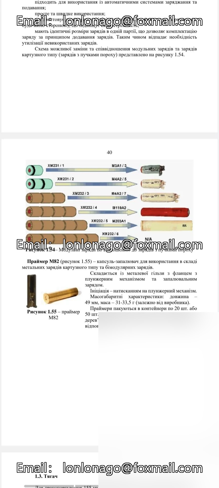
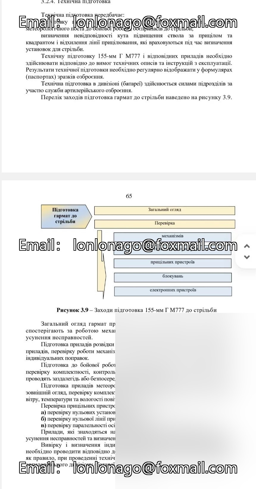

# The Ukrainian military's 155mm fragmentation grenade artillery M777A1 (A2) "155mm M"

## Body

The Ukrainian military's 155mm grenade cannon M777A1 (A2) - *Handbook on the M777A1 (A2) 155mm Grenade Cannon*.
PDF file, 150 pages.
April 2023 version, contents cover artillery tactics, cannon vehicle maintenance, combat readiness, shooting command, and cannon ammunition usage, with detailed structure diagrams and operational principle descriptions attached.
Electronic PDF, content is clear, suitable for research reference of military enthusiasts, model creation, and tactical research.
Sale and return free.
The biggest technical gap of the M777 lies in its highly digitized fire control system, which the "terrain preparation," "meteorological preparation," and "ballistic preparation" in the manual directory reflect:

Automatic solving: Traditional artillery requires manual lookup and complex geometric drafting, while the fire-carrying computer (DFCS) of the M777 can automatically receive GPS coordinates, measure wind speed and temperature, and instantly solve shooting elements (elevation angle and direction angle).
Quick fire and retreat: This automation greatly shortens the time for fire preparation.
The Ukrainians use their agility to frequently implement the "hit and retreat" tactic on the front line, rapidly shifting positions to avoid Russia's anti-artillery radar and drone reprisals.

This materials cover the technical manual for the Ukrainian military 155mm grenade launcher M777A1 (A2), including artillery tactics, carriage maintenance, combat preparation, shooting command and grenade usage, with detailed structural diagrams and principle explanations, provided in PDF format.

<!-- AI_ENRICHED -->

## Images

## Payment

Here is a pay link on Stripe ( https://buy.stripe.com/3cs8yP7sY87d0vu9AB ). Please contact me lonlonago@foxmail.com after funding $89, and I will send you a complete data files , thank you!

